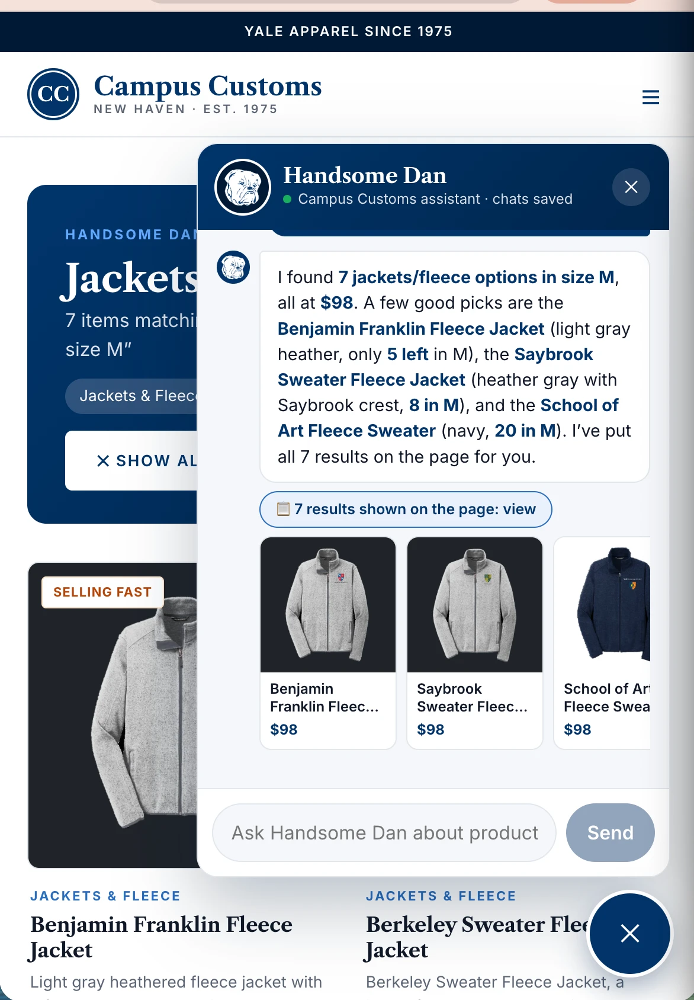
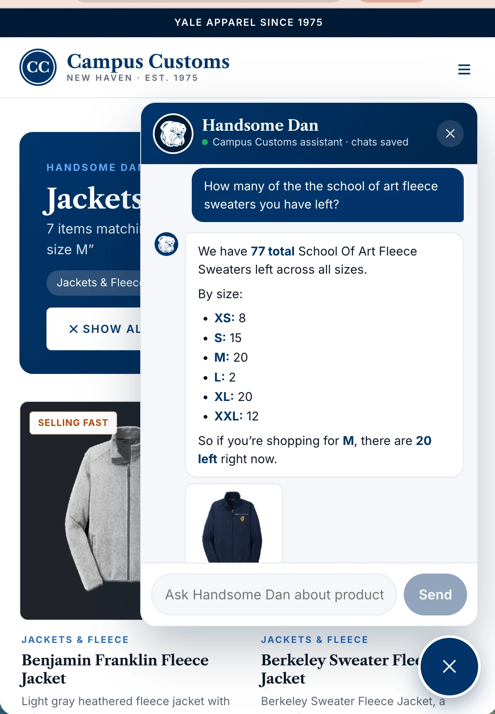
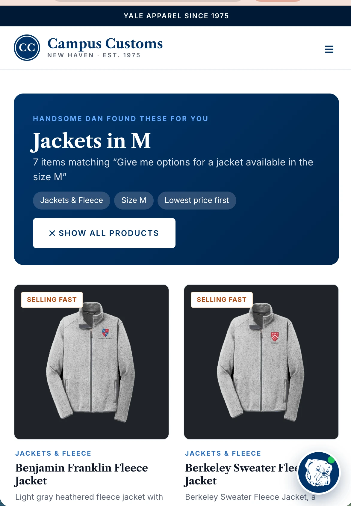

# Campus Customs: Yale Apparel Store + AI Shopping Assistant

**AI Foundations · Homework 4**

A storefront for **Campus Customs**, a family-run Yale apparel shop on Broadway in New Haven, with **Handsome Dan**, an AI shopping assistant that answers questions from the real product database.

- **Frontend:** React 19 + Vite + TypeScript (`frontend/`)
- **Backend:** FastAPI + PydanticAI agent via Portkey (`backend/`)
- **Data:** SQLite catalogue, inventory, users, and chat history (`data/`, not committed; see [Data setup](#1-data-setup))

| Chat search → product cards | Live inventory by size | Filter by category + size, sorted |
|---|---|---|
|  |  |  |

---

## Features

- **Storefront:** Home, Products (search, category + size filters, price sort), product detail (live stock per size), About Us, Login, Create Account. Yale-inspired design.
- **Accounts:** registration and login against the `users` table; PBKDF2-SHA256 with a unique salt per password; signed login tokens.
- **Handsome Dan chatbot** (bottom-right on every page):
  - Answers from the database through 5 read-only tools (search, details, stock, alternatives, categories). It never invents products, prices, or stock.
  - Chat searches **update the page** with matching product cards.
  - **Remembers** logged-in customers across sessions (saved in SQLite). Guests aren't saved.
  - Knows which **product page** you're viewing ("Is this available in pink?").
  - Recommends in-stock **alternatives** when something is unavailable, and asks a **clarifying question** (with tap-to-answer chips) when a request is vague.
  - **Safety rules** (privacy, wellbeing, no invented claims, manipulation resistance), **usage limits**, and an append-only, redacted **audit trail** (`output/audit_trail.json`).

---

## Project structure

```
hw4/
├── AI_prompts.md            ← prompts used to build this project (P1–P13)
├── requirements.txt         ← Python dependencies (backend + image scripts)
├── .env.example             ← copy to .env and add your keys
├── .gitignore
├── README.md                ← you are here
├── frontend/                # Vite React TypeScript app
│   ├── src/                 ← App, pages/, components/, api.ts, auth.tsx, brand.ts…
│   ├── public/              ← Handsome Dan art
│   ├── package.json / package-lock.json
│   └── .env.example         ← optional VITE_API_BASE
├── backend/
│   ├── main.py              # FastAPI app — run with: uvicorn main:app --reload
│   ├── agent.py             ← PydanticAI agent, deps, tool registration, run_chat()
│   ├── models.py            ← Pydantic models (API, agent output, tool outputs)
│   ├── tools.py             ← product & inventory tools (read-only SQLite)
│   ├── prompts/
│   │   └── prompt.md        ← Handsome Dan's instructions & safety rules
│   ├── config.py · db.py · auth.py · audit.py   ← config, SQLite, login, audit trail
│   ├── scripts/             ← make_cutouts.py, make_mascot.py (image assets)
│   └── test_tools.py · test_audit.py
├── output/
│   ├── harness.md           ← full technical reference
│   ├── design.md            ← P10 design rationale
│   ├── usability.md         ← P9 usability rationale
│   ├── app_check.html       ← interactive test checklist
│   ├── app_check_images/    # screenshots linked from app_check.html
│   └── audit_trail.json     ← append-only agent activity log (redacted)
└── data/                    ← NOT in git: campus_customs.db, products/, products_cutout/
```

---

## Prerequisites

| Tool | Version used | Notes |
|---|---|---|
| Python | 3.14 (3.12+ should work) | |
| Node.js / npm | 24.20 / 11.19 (Node 20+ should work) | |
| Portkey API key | n/a | With access to `@azure-openai-global/gpt-6-luna` (course account) |
| `data.zip` | n/a | Course-provided data (not in this repo) |

---

## Setup & run

### 1. Data setup

The database and product photos aren't committed (they contain customer accounts and licensed product imagery). Put the course's **`data.zip`** in this folder and unzip it:

```bash
cd hw4
unzip data.zip          # creates data/campus_customs.db and data/products/*.jpg
```

### 2. Backend (FastAPI), terminal 1

Python dependencies and the `.env` file live at the **`hw4/` root**:

```bash
cd hw4
python3 -m venv .venv
source .venv/bin/activate            # Windows: .venv\Scripts\activate
pip install -r requirements.txt
cp .env.example .env                 # then edit .env: set PORTKEY_API_KEY and SECRET_KEY

cd backend
uvicorn main:app --reload            # http://127.0.0.1:8000
```

- Health check: <http://127.0.0.1:8000/api/health> should show `"ok": true, "portkey_key_set": true`
- Interactive API docs: <http://127.0.0.1:8000/docs>

### 3. Frontend (React + Vite), terminal 2

```bash
cd hw4/frontend
npm install
npm run dev                          # http://localhost:5173
```

If the backend runs somewhere else, copy `frontend/.env.example` to `frontend/.env.local` and set `VITE_API_BASE`.

### 4. (Optional) Product image cutouts

The site shows each product on a backdrop that contrasts with the garment. Those cutouts are generated from the product photos, so they aren't committed either. Without them the site falls back to the original photos.

```bash
cd hw4/backend                       # with the venv active
python scripts/make_cutouts.py       # ~5 min → data/products_cutout/ (+ manifest.json)
```

(`scripts/make_mascot.py` regenerates the Handsome Dan art in `frontend/public/`. That art is already committed.)

### 5. Tests (no model calls, no API key needed)

```bash
cd hw4/backend                       # with the venv active
python test_tools.py                 # expect: 14 passed
python test_audit.py                 # expect: 6 passed
```

Then walk through `output/app_check.html` in a browser to check the app by hand.

### Production build

```bash
cd hw4/frontend && npm run build     # type-check + bundle into frontend/dist/
```

---

## Configuration

All backend settings live in `hw4/.env` (template: [`.env.example`](.env.example)).

| Variable | Required | Default | Purpose |
|---|---|---|---|
| `PORTKEY_API_KEY` | ✅ chat | n/a | Portkey gateway key |
| `SECRET_KEY` | ✅ login | n/a | Signs login tokens (any long random string) |
| `MODEL_NAME`, `PORTKEY_PROVIDER`, `PORTKEY_BASE_URL` | | `gpt-6-luna`, `@azure-openai-global`, Portkey v1 | Model routing |
| `CHAT_HISTORY_LIMIT` | | 20 | Past messages sent to the model |
| `AGENT_REQUEST_LIMIT`, `AGENT_TOOL_CALLS_LIMIT`, `AGENT_TOTAL_TOKENS_LIMIT` | | 8, 10, 150000 | Per-message agent limits |
| `PBKDF2_ITERATIONS` | | 600000 | Password hashing cost |
| `DB_PATH`, `AUDIT_PATH` | | `data/campus_customs.db`, `output/audit_trail.json` | Use copies for testing |

---

## Documentation

- **[`output/harness.md`](output/harness.md):** the full reference: database schema, API endpoints, agent design, tools, memory, security rules, agent limits, audit trail, troubleshooting (§14).
- **[`output/usability.md`](output/usability.md)**, **[`output/design.md`](output/design.md):** rationale for the usability and design work.
- **[`output/app_check.html`](output/app_check.html):** test checklist with screenshots (open in a browser; results save locally).
- **[`AI_prompts.md`](AI_prompts.md):** the prompts used to build each part.

---

## Security notes

- Never commit `.env`; it's in `.gitignore`. Only `.env.example` files with placeholders are tracked.
- `data/` (customer emails, password hashes, chat history, product photos) is ignored. `output/audit_trail.json` is committed as a deliverable. It contains only guest test conversations, and emails, card numbers, phones and passwords are redacted.
- Agent tools are read-only; customer identity comes only from the signed token; see `output/harness.md` §13–14.

## Known limitations

- **Seeded test accounts:** the three accounts in the provided DB were hashed with an unknown PBKDF2 iteration count. If they can't log in, set `PBKDF2_ITERATIONS` to the course's value. New accounts work regardless.
- No cart or checkout (the assistant tells customers to buy in store).
- The site doesn't claim to be officially licensed by Yale. Confirm licensing before using the "Y" or Handsome Dan marks in production.
